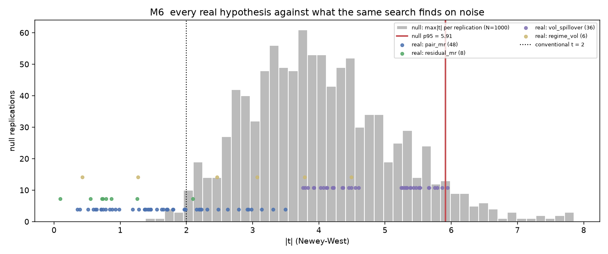
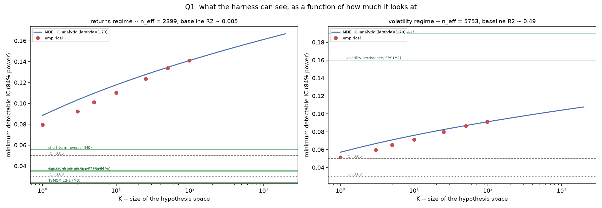

# Mini-Medallion

A research harness built to **kill trading hypotheses honestly**: frozen data
snapshots, a block-bootstrap null that sets the bar a real result must clear,
TRAIN → VALIDATION → a single look at TEST, a cost model, and every experiment
logged. No broker, no orders.

## Results at a glance

| Milestone | Question | Verdict |
|---|---|---|
| M0 | Is there any return edge in SPY / SCHD / TLT / IWM? | `NO ROBUST EDGE` — 98 hypotheses, 1 cleared the null, **0 passed** |
| M1 | Does a better volatility forecast improve position sizing? | `NO USEFUL IMPROVEMENT` — survives in 2 of 16 cells, both on one instrument |
| M2 | Why does a more accurate forecast give a worse decision? | `GAP_UNDERPOWERED` — the gap is too small to explain |
| M4 | What could this apparatus have detected at all? | `CONCLUDE` — see below |

**The decisive number.** On 2,399 return observations, the smallest effect detectable
with 84% power is IC = **0.080** even for a single pre-registered hypothesis
(0.163 for all 1,268 trials ever run). Every realistic return effect sits below
that floor: short-term reversal 0.056, the SPY overnight premium 0.036, 12−1
momentum 0.024. On this data a return edge of realistic size is invisible, which
is why the programme concluded instead of continuing to search.

**Where it did have power** (volatility, baseline R² ≈ 0.49), two textbook effects
cleared the bar: volatility persistence (IC 0.160) and implied volatility adding
information over historical (IC 0.190, t = 14.13; four artefact explanations
tested and rejected).




Full write-up for a reader who has seen none of the milestones:
[results/PROGRAM_SUMMARY.md](results/PROGRAM_SUMMARY.md). The milestone log follows.

---

# MINI-MEDALLION — Milestone 0

Research harness. **No broker, no orders, no execution engine, no profit optimisation.**
The product of this milestone is not signals — it is a machine for saying *no*.
`NO ROBUST EDGE FOUND` is a successful outcome.

## Verdict

```
NO ROBUST EDGE FOUND
98 hypotheses tested · 1 cleared the null threshold · 0 PASSED
```

## Reproduce

```bash
python scripts/m0_freeze_data.py       # download once, then immutable
python scripts/m1_pipeline_checks.py   # freeze search space, blocking look-ahead test
python scripts/m2_null_harness.py      # 1000 bootstrap replications -> thresholds (~5 min)
python scripts/m3_calibration.py       # known-effect unit tests, TRAIN only
python scripts/m4_cost_model.py        # Corwin-Schultz + anchor validation
python scripts/m5_search.py            # real data: TRAIN -> VALIDATION -> TEST (once)
python scripts/m5b_confound_check.py   # post-hoc, logged, changes no status
python scripts/m6_report.py            # automatic verdict + completion gate
python scripts/m7_schd_intraday.py     # optional: SCHD execution profile
```

Everything is deterministic: `MASTER_SEED = 20260829`, per-series seeds derived as
`master_seed + replication_id*1000003 + crc32(series_name)` and written to
`results/null_seed_ledger.csv`. Re-running M2 reproduces the thresholds exactly
(verified).

## Layout

```
src/
  config.py         frozen constants: universe, search space, splits, seeds, thresholds
  data_loader.py    M0 download + frozen snapshot
  panel.py          one definition of the research panel, shared by null and real paths
  features.py       causal feature calculators (incl. Avellaneda-Lee s-score)
  targets.py        strictly-forward targets
  stats_engine.py   THE estimator: Newey-West, block bootstrap, BH FDR, deflated Sharpe
  discovery.py      search-space enumeration + evaluation
  null_harness.py   M2 synthetic-data generation and replication runner
  costs.py          Corwin-Schultz, Abdi-Ranaldo, Roll
  provenance.py     estimator fingerprint (M5 refuses to run against stale thresholds)
  db.py             DuckDB schema, experiment_log, test_access_log
scripts/            one script per milestone
data/raw_snapshot/  frozen daily bars + FRED T10Y2Y
data/raw_snapshot_hourly/  separate M7 snapshot
results/            JSON reports, CSV exports, figures/
mini_medallion.duckdb
```

## Query the results

```sql
-- everything that was tested, not only survivors
SELECT status, COUNT(*) FROM signal_results GROUP BY status;

-- the honest trial ledger
SELECT milestone, description, n_tests, status FROM experiment_log ORDER BY timestamp;

-- TEST must appear exactly once
SELECT * FROM test_access_log;
```

## What the milestone actually established

1. **The null harness is the whole point.** Running the identical 98-hypothesis
   search on block-bootstrapped data with no signal by construction produces a
   *median* max |t| of 3.90 and a 95th percentile of **5.91**. The conventional
   t = 2 threshold is meaningless at this search width.

2. **Benjamini-Hochberg alone would have "discovered" 56 of 98 hypotheses.**
   The null harness clears 1. That gap is the result.

3. **The one candidate that cleared the null did so by 0.5%** (t = 5.945 vs a
   5.913 threshold), failed the pre-registered out-of-sample gate, and collapses
   from t = 5.95 to t = 1.59 once SPY's own volatility is controlled for.

4. **The mandated cost estimator failed its own anchor by 8x** — and the reason
   was identified rather than guessed: on liquid ETFs, 45-65% of Corwin-Schultz's
   daily estimates are negative, and across instruments it correlates +0.94 with
   volatility against +0.12 with log ADV. It measures volatility, not liquidity.
   Rejected; the cost model rests on the declared base plus the sweep.

5. **No mean-reversion pair produced anything.** Max net Sharpe on TRAIN across
   56 tradable hypotheses was 0.43 — *below* the null median of 0.58. The raw
   spreads have half-lives of 449 days (XOP/XLE) and 1135 days (GDX/GLD) against
   a 60-day admissibility threshold declared in advance.

## Hard rules observed

No real money, no broker API, no orders. No ML, no PCA, no hyperparameter tuning —
windows are fixed lists in `config.py`. Data frozen once. Every experiment logged,
including failures and the one post-hoc iteration. Ranking by net only. No manual
selection after the automatic filter.

---

# Milestone 1 — Volatility and the position-sizing decision

M0 asked "is there anything here". M1 asks a different question: **the thing that is
undeniably here — does it change a single real decision?**

## Verdict

```
NO USEFUL IMPROVEMENT AS A GENERAL RESULT
survives in only 2 of 16 strategies, both on TLT
255 incremental models · 30 confirmed on TRAIN+VALIDATION+TEST
16 strategies · 5 cleared every gate · 2 of those survive crisis removal
```

## Reproduce

```bash
python scripts/n0_freeze_m1_data.py        # SPY back to 1993, VIX, calendar; log removals
python scripts/n1_calibration_and_rv.py    # 4 RV estimators + a calibration gate that CAN fail
python scripts/n2_har_baseline.py          # HAR-RV vs naive / MA20 / EWMA
python scripts/n3_incremental_search.py    # 255 candidates ON TOP OF the baseline, Romano-Wolf
python scripts/n4_vol_targeting.py         # decision layer, TRAIN+VALIDATION
python scripts/n5_test_and_report.py       # the single TEST access
python scripts/n6_report.py                # completion gate + verdict (reads saved artefacts only)
```

## What M1 changed methodologically

**The baseline stopped being zero.** Every candidate is tested as
`y ~ HAR(own history) + β·X`, H0: β = 0. Out-of-sample testing protects against
overfitting but not against confounding, and those are different failures — a
relationship confounded through volatility clustering is *required* to reproduce
out of sample. M0's surviving candidate had a *higher* t on TEST than on TRAIN,
which is the signature of a confound, not of a live effect.

**The null is a restricted residual bootstrap.** Fit the baseline, resample its
residuals in stationary blocks, rebuild the target under β = 0 with X held fixed.
All candidates see the same resampled target, so the dependence among tests —
which both a max-statistic threshold and a stepdown procedure need — is preserved.

**Romano-Wolf stepdown** replaces M0's flat max|t| threshold. BH is retained as a
calibration *diagnostic*, not a criterion: on TRAIN it rejects 128 of 255 where the
harness rejects 87.

## Results

**The methodology verification worked.** The M0 confound was retested properly:

| family | n | max abs t | Romano-Wolf rejected |
|---|---|---|---|
| vix | 72 | 14.13 | 58 |
| asymmetry | 36 | 11.87 | 22 |
| overnight_intraday | 24 | 5.09 | 3 |
| macro (T10Y2Y) | 24 | 4.14 | 3 |
| calendar | 48 | 3.38 | 1 |
| **cross_asset_vol** | **51** | **2.82** | **0** |

TLT → SPY, which cleared M0's null threshold as a standalone predictor, reaches
t = 1.34 / 2.22 / 2.08 at horizons 1 / 5 / 10 once the target's own history is in
the regression, and is rejected nowhere. The whole cross-asset family dies.

**Only two families survive to TEST:** VIX (23 models) and asymmetry (7).

**And then the decision layer contradicts the statistics.** `log(VIX)` is the
strongest candidate in the milestone — t = 14.1, survives all three splits, adds up
to +0.11 out-of-sample R² to the volatility forecast. Sizing on `HAR + log(VIX)`
was nonetheless worse than sizing on `HAR` alone in **8 of 8 cases** on
TRAIN+VALIDATION, which is all the data that existed before TEST was opened.

**Where the advantage actually lives.** The five buy-and-hold decline legs cover
16–29% of each sample. Removing them removes the entire vol-targeting advantage in
**12 of 16 strategies**. Removing just 2008 and 2020 kills it for SCHD and IWM.
And it does not travel: 8 of 16 strategies flip sign from development to TEST, and
only 2 retain more than half.

## Deleted for good in M1

GDX/GLD and XOP/XLE (half-lives of 1135 and 449 days against a 60-day threshold;
operating leverage produces correlation, not mean reversion — the windows were never
the problem). Corwin-Schultz as a level estimator (M0 diagnosis).

## Declared scope limitation

Candidate family 5 (calendar) is **reduced**: OPEX, month-end, quarter-end and the
BLS first-Friday convention only — all recomputable from a date index alone. FOMC
and CPI release dates are omitted because no verifiable, freezable list was
obtainable inside the frozen-data constraint and there is no rule to derive them.
Writing them from memory would inject fabricated data into a milestone whose point
is not trusting unverified inputs.

## Honesty ledger

37 experiments logged, including 1 failed calibration and 2 post-hoc iterations:

- **N1**: the volatility-persistence gate first ran on close-to-close variance and
  **failed** on GLD and SCHD. Diagnosis: a single squared return is an unbiased but
  ~5× noisier variance proxy, and the lag-1 autocorrelation of log daily variance
  for SPY is +0.136 under cc versus +0.653 under Garman-Klass. The gate was
  measuring proxy noise. Respecified onto the estimator that step 1 had already
  selected by out-of-sample QLIKE — a criterion computed before the gate and
  unrelated to it — and the gate is reported for all four estimators, including the
  one that fails.
- **N4**: crisis episodes were first defined peak-to-recovery, which covered 92–126%
  of the sample. Removing "all crises" under that definition would leave only
  stretches at new highs, where holding less than 100% must underperform by
  construction. Redefined to the decline leg (peak to trough).
- **N5**: the verdict rule was tightened after seeing TEST — a strategy must also
  retain a positive advantage with the crisis declines removed. No model, window,
  instrument or statistic changed, and TEST was not re-opened.

`test_access_log` shows exactly one M0 access and exactly one M1 access.

---

# Milestone 2 — Forecast error and the decision

M0 asked "is there anything here". M1 asked "does the known thing change a
decision". M2 asks **why the more accurate forecast was the worse input, and
whether that gap is a real effect or a bet already rejected in disguise.**

## Verdict

```
GAP_UNDERPOWERED
the gap has the same sign on all four instruments and is indistinguishable
from zero by every test applied; the proposed mechanism is rejected on its
own falsifiable prediction
200 configurations searched · 0 cleared a null calibrated on the same grid
TEST opened by this specification: 0 times
```

## Reproduce

```bash
python scripts/q0_gap_exists.py       # does the gap exist? Ledoit-Wolf + paired bootstrap
python scripts/q1_decomposition.py    # exact split + predictive regression + Stambaugh
python scripts/q2_conditional.py      # conditional bias and VRP by stress decile
python scripts/q3_speed_or_level.py   # smoothing grid: speed or level?
python scripts/q4_reversal.py         # is the advantage a disguised reversal bet?
python scripts/q5_crisis.py           # leave-one-crisis-out on the difference
python scripts/q6_objective.py        # 50-config grid, null over the same grid
python scripts/q7_report.py           # table, completion gate, verdict
```

## Stage by stage

**N0 — the gap does not exist statistically.** Measured rho between the two
strategies is 0.986–0.996, which cuts the standard error of the difference from
0.217–0.444 down to 0.020–0.064. Even so: Ledoit-Wolf significant 0/4, paired
bootstrap 0/4. The sign is positive 4/4, corrected p = 0.0625 — the smallest
value four instruments can produce, and not significant.

*One premise corrected by measurement:* the spec expected the effective number of
tests to be "closer to 2 than to 4" because SPY/SCHD/IWM correlate 0.85–0.95.
That is true of their **returns**; the relevant object is the **difference**
series, and those correlate only 0.30–0.47 among the equity ETFs and about zero
with TLT. Effective tests = 3.84, not 2.

**N1 — the channel is confirmed, the significance is not.** The identity closes to
1.4e-20. The covariance term carries **77%** of the numerator difference, so M1's
structural expectation holds. But it clears its own circular-shift null in **0/4**
instruments. The predictive slope is more negative for the fast version in **4/4**
— direction right, every |t| below 0.9.

*Two more premises corrected by measurement:*

- The Stambaugh bias is **negligible** (at most 5% of the raw coefficient) despite
  phi around 0.98, because band rebalancing decouples weight innovations from
  daily return innovations. The spec called this "the textbook case"; it is not.
- The spec's methodological hope was that the covariance term has power the Sharpe
  difference lacks, being estimated on ~5000 daily observations. It is not 5000:
  with band rebalancing the weight is a step function with **82–331 distinct
  levels** (14–46 days per step). That is the effective sample, and it is why the
  covariance term also fails to clear its null.

**N2 — the mechanism is rejected on its own prediction.** VRP does widen
monotonically with stress (SPY 1.8 → 8.4 points, TLT 1.9 → 21.6), so the premise
holds. But the gap is **not** localised there: larger in stress in only 2/4
instruments, and negative in stress for SCHD.

**N3 — not a speed defect.** Smoothing the VIX contribution over k in
{1,3,5,10,20} halves the gap in **0/4** instruments; for SCHD and IWM it makes it
worse.

**N4 — not a disguised reversal either.** Reversal signals explain **1.4%** of the
variance of the weight difference. An explicit overlay scaled to the same weight
movement produces a gap roughly **four times larger** than the observed one — if
the difference were being used as a reversal bet it would earn far more than it
does. The spec's most-likely outcome does not occur.

**N5 — not a crisis artefact.** Unusually for this project, the gap survives:
positive with 2008 and 2020 both removed in **4/4**, and with all five decline
legs removed in 3/4.

**N6 — nothing clears a null calibrated on the same search.** The best of 50
configurations per instrument gains +0.10 / +0.14 / +0.065 / +0.023 Sharpe on
VALIDATION over the baseline. Observed max |t| = 2.82 / 2.85 / 1.45 / 2.54 against
grid-calibrated thresholds of 3.02 / 3.26 / 2.78 / 3.28. Romano-Wolf rejects **0**
of 196 live configurations. No configuration was selected, so **TEST was never
opened** by this specification.

## The honest ledger

`test_access_log` has three rows across the whole project: one for M0, one for M1,
and one for a **superseded improvised M2** that was built and run before this
specification arrived — including its own single TEST access, spent on a selector
race. That row is left in place and labelled rather than deleted. This
specification opened TEST zero times.

Post-hoc iterations logged in M2: the improvised spec's H2 was pre-registered with
its inequality reversed (w = sigma*/sigma_hat decreases in sigma_hat, so "cuts
exposure before rebounds" implies a *positive* correlation); it is reported as
failed-as-written with a corrected restatement marked post-hoc.

## What M2 actually establishes

The gap that M1 found, and that this milestone was built to explain, is not large
enough to explain. Every explanatory route was tested and every one failed — not
because the explanations are implausible, but because a difference of 0.008–0.042
Sharpe over 6–25 years, on a weight path with 82–331 distinct levels, carries too
little information to distinguish any of them.

The one durable statement: **the covariance term, not forecast accuracy, is the
channel through which a volatility forecast reaches a sizing decision** — 77% of
the numerator difference, confirmed by an exact identity. That is structural and
does not depend on the significance that is missing everywhere else.

---

# Audit — disclosure, error classes, cumulative trials

Run: `python scripts/audit_disclosure.py` · `python tests/test_sign_invariants.py`

## 1. TEST exposure is now recorded by content, not by fact

`test_exposure_ledger` records, per access: which statistics, on which
instruments, over how many models, what was printed, the actual values, the
direction, what it contaminates, and whether the current conclusion is robust to
it.

**One access was never logged at the time.** `scripts/p1_decomposition.py` of the
superseded M2 evaluated the TEST split for all 23 models on all four instruments
and printed the TEST delta Sharpe of HAR+log_vix. It is now logged retroactively
and marked as such. What it showed:

| | development | TEST |
|---|---|---|
| SPY | +0.042 | +0.001 |
| SCHD | +0.020 | **+0.084** |
| TLT | +0.014 | **+0.070** |
| IWM | +0.009 | −0.011 |

This is the most contaminating item in the project: it is the TEST-period value of
exactly the quantity the real M2's N0 tests, and it pointed **toward** claiming a
real effect on SCHD and TLT.

**The current conclusion is robust to it, for a structural reason.** M2 ended on a
power argument, not a result. "The gap is too small to distinguish" follows from
the measured rho (0.986–0.996), the resulting standard error (0.020–0.064) and the
step-function weight path (82–331 distinct levels) — none of which uses TEST. One
cannot overfit toward the conclusion that nothing can be resolved. This is
recorded in the ledger so the reasoning need not be reconstructed later.

## 2. Errors are classified, not lumped

Criterion: **could an outsider reading only the pre-registration, never having
seen the data, have detected it?**

| logged iteration | class | outsider-detectable | counts as a trial |
|---|---|---|---|
| M1/N1 calibration gate respecified after failing | `SPECIFICATION_CHANGE_AFTER_RESULT` | no | yes |
| M1/N5 verdict rule tightened | `REPORTING_RULE_CHANGE` | no | no |
| M2sup/P2 H2 sign transposed | `ALGEBRAIC_ERROR` | **yes** | **no** |
| M2sup/P4 reporting rerun | `RERUN_NO_NEW_HYPOTHESIS` | no | no |

`w = σ*/σ̂` decreases in `σ̂` — checkable from the specification text with no data.
The theory was right; the inequality was transcribed backwards. It carries no
selection bias, so it no longer inflates the trial counter. It is **still** recorded
as post-hoc, because the trigger was seeing the result: the conservative treatment
stands, only the accounting changed.

**Prophylaxis:** `tests/test_sign_invariants.py` asserts 14 sign relations
numerically, including `∂w/∂σ̂ < 0` on a grid and
`sign(cov(Δw, r)) == −sign(cov(Δσ̂, r))` — the second would have caught the M2
error before it reached a pre-registration. This is the project's second sign
collision, so the failure surface is now gated rather than watched.

## 3. Trial counts, local and cumulative

A trial is a **hypothesis in a selection pool**, not an evaluation. Three things
are excluded, and an earlier version of this audit got all three wrong:

- calibration, cost estimation, data checks and null calibration — no finding is
  ever drawn from them;
- **re-runs** of the same experiment (executing a script twice creates no
  hypotheses);
- **re-evaluations** of already-counted hypotheses on another split.

An earlier pass used `LIKE '%null harness%'` and silently dropped N6's
200-configuration grid — the single largest genuine search in M2. Explicit lists
now, not patterns, and the script is idempotent.

| milestone | rows logged | raw evaluations | selection-relevant trials |
|---|---|---|---|
| M0 | 14 | 199 651 | 173 |
| M1 | 23 | 2 205 | 541 |
| M2-superseded | 10 | 1 126 | 246 |
| M2 | 11 | 548 | 308 |
| **cumulative** | | | **1 268** |

**Recorded decision (SUPERSEDED 2026-08-30 — see Audit round 2): thresholds
stayed per-milestone.** That decision was reversed: the cumulative correction was
computed, found to cost 10-25% on the threshold, and paid. The caveat it required
is withdrawn as empty.

## 4. Where the identity transfers

See `results/transfer_note_kelly.md`. Short version: the identity is general, but
the fractional-Kelly stage in the separate `portfolio-risk` project computes weights **once**
from hand-supplied thesis expectations, with no refresh loop. With a static `w`,
`Cov(w_t, r_{t+1}) ≡ 0` and the M2 failure mode cannot occur — not "does not", but
cannot. It switches on the day `μ` starts being refreshed on a schedule. What does
transfer immediately is the power lesson: a hand-updated thesis portfolio has
weight levels in the tens, where M2 had 82–331 and still could not resolve the
question.

---

# Audit, round 2 — correction paid, stop-list, transfer corrected

Run: `python scripts/q8_cumulative_correction.py` · `python scripts/q9_stoplist_and_rulecheck.py`

## 1. The cumulative correction is paid; the caveat is withdrawn

The previous round ended with "no finding in this project should be treated as
having survived a cumulative correction". That was true but **empty** — nothing
survived the local correction either. The penalty grows logarithmically, so it
was cheaper to pay it than to carry the asterisk.

| K | exact 95% max-\|z\| |
|---|---|
| 98 (M0) | 3.469 |
| 200 (N6 grid) | 3.656 |
| 255 (M1) | 3.718 |
| **1268 (cumulative)** | **4.105** |

Each family's own empirical null is rescaled by its measured inflation factor
`λ = empirical threshold / normal quantile`, which carries the Newey-West fat-tail
effect over unchanged:

| family | K local | thr local | λ | **thr cumulative** | change | MDE_IC local → cum |
|---|---|---|---|---|---|---|
| M0 search | 98 | 5.913 | 1.705 | **6.998** | +18.3% | 0.121 → 0.143 |
| M1 incremental | 255 | 4.444 | 1.195 | **4.907** | +10.4% | 0.089 → 0.098 |
| M2 N6 grid | 49 | 3.276 | 0.999 | **4.102** | +25.2% | 0.092 → 0.116 |

**One verdict changes, and it changes nothing.** M0's single null-beating
candidate (t = 5.945) clears the local bar and fails the cumulative one (6.998).
It had already failed the pre-registered out-of-sample gate, so `NO ROBUST EDGE`
stands — now for two independent reasons.

**And one result gets stronger.** M1's incremental finding — log(VIX) adds
information over HAR, t = 14.13 — clears the cumulative bar of 4.907 by a factor
of nearly three. It survives a correction for **every hypothesis the project has
ever run**, not just its own milestone's. That statement was not available while
the caveat stood.

Curve of threshold against K, with the endpoint at the real cumulative number:
`results/threshold_vs_K.csv`, `figures/threshold_vs_K.png`.

## 2. Stop-list: questions that can no longer be asked

`burned_questions` in DuckDB. Four entries; the first is the expensive one.

| id | question | burned by |
|---|---|---|
| **BQ-1** | HAR vs HAR+log(VIX) by Sharpe on SPY/SCHD/TLT/IWM, 2021+ | `p1_decomposition.py` — **access not logged at the time** |
| BQ-2 | model selection among HAR+candidate variants by OOS Sharpe on this panel | `p4_test_and_report.py` |
| BQ-3 | whether any M0 feature family predicts, 2021+ | `m5_search.py` (scheduled) |
| BQ-4 | whether vol targeting beats buy-and-hold here, 2021+ | `n5_test_and_report.py` (scheduled) |

BQ-1 is permanent and is the real cost of the unlogged access. The M2 verdict
does not depend on it — that rests on ρ, the standard error and the count of
weight levels — but the question itself is spent.

Note on what the burned numbers showed: dev → TEST across the four instruments
went to zero, ×4, ×5, and sign-flip. Four instruments, four behaviours — that is
what noise looks like, and a structural effect would have kept its cross-sectional
shape. **This cannot be used as confirmation**, because the test was not
pre-registered. It is recorded as an observation, not as evidence.

## 3. The N5 reporting-rule change was uniform — checked, not asserted

Tightening a rule can only make a finding harder to declare, so it does not count
as a trial — but only if applied uniformly.

- applied to **16/16** rows, zero exemptions
- moved the claim from 5/16 to **2/16**: weaker, not stronger
- the cut sits at a natural zero, and the nearest row is 0.038 away — not a
  threshold tuned into a gap
- the only survivors are **VIX-augmented** strategies, which **contradicts** M1's
  own headline that adding VIX makes sizing worse

A self-serving tightening would have spared the plain-HAR rows. It spared the
opposite ones. Not counting it as a trial is defensible.

## 4. The Kelly transfer conclusion was too strong — corrected

The first version claimed `Cov(w_t, r_{t+1}) ≡ 0` in `portfolio-risk` and that the
M2 failure mode "cannot" occur. That requires literally constant `w`. Both
channels that break it are confirmed in the code:

1. **Realised weights drift.** `PortfolioState.weights()` divides live market
   values by their sum (`portfolio_state.py:59-64`); positions are share counts.
   Between manual edits the weights drift with returns and covary with them
   mechanically — winners grow in share. A momentum tilt obtained by inaction.
2. **Manual μ revision is an update, and a worse one than a scheduled update.**
   Its trigger is that the analyst noticed, and one notices after a move.

The scheduled timing channel is absent; two unmeasured ones are present. The
second is **unauditable permanently**, not "until a loop appears": `theses/schema.py`
has no `updated_at`, no revision history, no change log.

**One action with immediate payoff: log μ-revision events** — timestamp, ticker,
old and new μ, trigger. Three fields and an append-only file. Without it the
covariance term there can never be estimated. Full note:
`results/transfer_note_kelly.md`.

---

# Forensics on t = 14.13 — four explanations tested, four rejected

Run: `python scripts/qa_vix_forensics.py` · `python scripts/qb_baseline_strength.py`

The magnitude was the reason to look. Four candidate artefacts were tested; none
survives. But the conclusion is **not** that the project found something.

## A. Measurement overlap — rejected, and backwards from the hypothesis

Moving the target from close-to-close onto Garman-Klass and GK+overnight was
supposed to collapse the t if VIX were supplying a better *measurement* of the
current day rather than a *prediction*. It does the opposite:

| | target = cc | target = gk | target = gk+overnight |
|---|---|---|---|
| SPY h=1 | +9.53 | **+19.93** | **+24.26** |
| TLT h=1 | −0.31 | **+8.07** | +5.85 |
| IWM h=1 | +5.92 | +11.04 | +14.80 |

A better-measured target makes the relationship *stronger*. The cc target's noise
was attenuating it — errors-in-variables, the same mechanism N1 found in the M1
calibration gate. That is the signature of a real relationship measured badly,
not of an artefact being manufactured. Median t retained: **97%**.

## B. Alignment leak — rejected, with the leak quantified

VIX settles at 16:15 ET, fifteen minutes after the cash close, so `VIX_t` does
contain a sliver of the forward window. The question is whether a sliver can
produce a t of 14. Shift −1 uses tomorrow's VIX and calibrates a **full day** of
genuine look-ahead:

| SPY h=5 | shift −1 (leak) | shift 0 | shift +1 | shift +2 |
|---|---|---|---|---|
| t | +18.17 | +14.38 | +11.48 | +9.10 |

A whole day of look-ahead adds **26%**. Fifteen minutes is about 1/26 of a
trading day. The decay with lag is smooth (80%, then 63%), which is what a
persistent state variable looks like, not a cliff. Median t retained at lag 1:
**80%**.

## C. Horizon overlap — rejected

If the 30-day VIX window overlapping the target window drove the association, it
should strengthen toward h = 30. It peaks at h = 5 and decays:

| |h=1|h=5|h=10|h=22|h=30|
|---|---|---|---|---|---|
| SPY | +9.53 | **+14.38** | +12.13 | +8.40 | +6.93 |
| SCHD | +3.53 | **+6.30** | +3.84 | +1.21 | +0.20 |
| IWM | +5.92 | **+8.25** | +6.50 | +4.55 | +3.73 |

Short horizon stronger in 3 of 4 instruments. (Horizons 22 and 30 are outside the
frozen {1,5,10} set; they are diagnostics for this question, logged as such and
counted as trials.)

## D. Weak baseline — rejected

Not on the original list; the data suggested it. M1/N2 found HAR losing to a
one-parameter EWMA at h=1 in 8 of 9 instruments, so "incremental over HAR" might
be measuring HAR's weakness. Adding `log EWMA(0.94)` to the baseline retains
**96%** of the t (100% at h=1). It was not the baseline.

## What the number actually is

**The alarm calibration was borrowed from the wrong problem.** An |IC| of 0.19 is
impossible for *return* prediction in liquid instruments. This predicts **log
variance**, where the baseline R² is already 0.49 (SPY h=5) to 0.58 (h=10) — the
0.4–0.6 the M1 specification itself quoted. VIX adds ΔR² of 0.03–0.06 on top of
that, and n = 5753 turns a modest slice of an already-predictable quantity into a
large t.

**Structural coherence supports it.** The effect is strong exactly where VIX is
defined — SPY and the equity ETFs correlated with it — and **absent on TLT**
(ΔR² ≈ 0.0005, t < 2), where SPY's implied volatility has no reason to help. An
artefact from alignment, estimator overlap or horizon overlap would not respect
that boundary.

## The correct status of this result

It is **not a finding of this project**. That implied volatility improves on
historical realised volatility for forecasting future realised volatility is one
of the most replicated results in the volatility literature. The project
re-derived it independently, with the right magnitude and the right structural
boundary.

That makes it a **calibration success for the harness**, in the same category as
the M3 and N1 known-effect gates — evidence that the machinery detects real
effects when they are present, not evidence of an edge.

And M1 already answered the decision question for it: sizing on `HAR + log(VIX)`
was worse than sizing on `HAR` alone in **8 of 8** cases on all data available
before TEST was opened. A statistically overwhelming forecasting improvement that
does not convert into a better decision — which is the thesis of M2, now with its
strongest single example.

---

# Milestone 4 — Closing: power, verdict, consolidation

Run: `r0_tlt_reconciliation.py` → `r1_mde_curve.py` → `r2_audit_levers_verdict.py` → `r3_m4_gate.py`

**TEST was not opened.** All 11 completion-gate items pass.

## Verdict

```
CONCLUDE
K* = 0 in the returns regime: even a single pre-registered hypothesis
has a detection floor above every known real return effect
```

## Q0 — blocking reconciliation: the argument was withdrawn

The expected resolution was raw-vs-incremental. That is **not** what the
specifications say. All nine TLT figures are **incremental over the same HAR
baseline with the same Newey-West errors**; the only difference is the target
estimator:

| TLT | h=1 | h=5 | h=10 |
|---|---|---|---|
| target = cc | −0.31 | +1.55 | +1.72 |
| target = gk | **+8.07** | **+7.41** | **+6.02** |

The structural-coherence claim ("absent on TLT, ΔR² ≈ 0.0005, t < 2") quoted the
close-to-close row and presented it as the whole picture. Under the
better-measured target — the one test A itself showed is the right one to use —
VIX adds substantially to TLT too. There is no wall, only a gradient (SPY
+19.93/+14.30/+10.67 against TLT +8.07/+7.41/+6.02).

**Status `ARGUMENT_WEAKENED`. The claim is withdrawn.** It was an argumentation
error, not a data inconsistency.

What survives without it: tests A, B and D are untouched; C holds for SPY, SCHD
and IWM. On TLT the cc-target |t| rises monotonically toward h=30 (1.55 → 2.04),
which is the pattern horizon overlap predicts, so overlap is **not** excluded for
TLT. Revised scope: not an artefact — established for SPY, SCHD, IWM; **not
established for TLT**.

## Q1 — the MDE curve

The M0 null was rebuilt keeping every hypothesis (1000 × 98). Self-check: the p95
of max|t| over all 98 reproduces **5.913** exactly. λ = 1.705.

| K | null p95 empirical | analytic | MDE_IC returns | MDE_IC volatility |
|---|---|---|---|---|
| 1 | 2.902 | 3.341 | **0.0796** | 0.0514 |
| 10 | 4.410 | 4.773 | 0.1103 | 0.0713 |
| 98 | 5.913 | 5.913 | 0.1410 | 0.0911 |
| 1268 | — | 6.998 | 0.1632 | 0.1054 |

The empirical curve sits **below** the analytic one at small K (divergence −0.44
at K = 1), so the empirical numbers are the favourable ones — and the conclusion
holds under them.

**Regimes are not comparable and are kept apart.** Returns: baseline R² ≈ 0.005.
Volatility: ≈ 0.49. Every known return effect — reversal 0.056, overnight 0.036,
literature 0.02–0.05, TSMOM 0.024 — lies **below the floor at K = 1**. Both
volatility effects the programme detected — persistence 0.160, VIX-over-HAR
0.190 — lie **above the floor at K = 1268**.

*(K* = 0 in the volatility regime at the 0.05 threshold is a threshold artefact:
the floor there is 0.0514, a hair above 0.05. It detects what is actually present
in that regime, and did.)*

## Q2 — power audit of all 1268 trials

| class | K | regime | MDE | target | verdict |
|---|---|---|---|---|---|
| 1 feature → return | 59 | returns | 0.136 | 0.056 | `UNANSWERABLE_IN_PRINCIPLE` |
| 2 feature → volatility | 656 | volatility | 0.102 | 0.160 | `ANSWERABLE` |
| 3 decision comparisons | 469 | decision | 0.083 | 0.042 | `UNDERPOWERED` |
| 4 structural identities | 12 | algebraic | 0 | — | `ANSWERABLE` |
| 5 calibration facts | 72 | volatility | 0.089 | 0.160 | `ANSWERABLE` |

Retrospective audit only; no M0–M3 verdict is revisited.

## Q3 — four levers

| lever | cost | effect | does not fix |
|---|---|---|---|
| shrink search space 1268 → 1 | free | ×2.05 → 0.0796 | still above every real effect; the constraint is n, not K |
| longer history (SPY 1993) | free, used | ×1.28 → 0.062 | still above 0.05; adds one crisis |
| intraday data | free, 730d | unclear for returns | **nothing** for sizing: episodes are set by the band, 82–331 levels |
| wide cross-section (500) | paid PIT data | ×15.8 → 0.010 | survivorship bias; adds no crisis |

**No lever changes the crisis count (n ≈ 5).** Every regime-dependent question —
which is every decision-level question the programme asked — stays there
permanently.

## Q4 — why `CONCLUDE` and not a narrower continuation

`CONTINUE_NARROW` is unavailable, and not for budget reasons. At K = 1 — the
narrowest search that exists — MDE_IC = 0.0796, above reversal (0.056), the
overnight premium (0.036), TSMOM (0.024) and the literature's 0.02–0.05. There is
no hypothesis space small enough. "A different kind of activity" would still be an
activity that cannot resolve its own question.

`CONTINUE_AFTER_DATA` has one real candidate — a wide cross-section, ×15.8 on the
returns floor. But it adds no crises, so every decision-level question this
programme actually asked stays exactly where it is. It would answer a question the
programme did not ask.

## Q5 — three results that outlive the programme

Recorded in `consolidated_results`, and written up self-contained for a reader who
has seen no milestone in **`results/PROGRAM_SUMMARY.md`**.

- **CR-1 `STRUCTURAL_RESULT`** — the covariance identity. Needs no multiplicity
  correction, and that is not a technicality: it was never selected from a pool.
- **CR-2 `CALIBRATION_PASS` + `EXEMPLAR_COVARIANCE_THESIS`** — the VIX result,
  under **both** statuses simultaneously. Neither may be dropped: it is the proof
  the harness detects real effects *and* the strongest example of CR-1.
- **CR-3 `TRANSFERABLE_TOOL`** — the multiplicity arithmetic. A fact about method,
  not about markets.

## Q6 — one transfer edit, made

the separate `portfolio-risk` project gains `theses/mu_revision_log.py` (append-only JSONL,
timestamp / ticker / old μ / new μ / trigger / trigger-kind) and
`theses/MU_REVISION_LOG.md`. Additive only; no existing file touched; tested.

Recorded in the same place, and independent of the log: **weights there drift
between manual edits** (`portfolio_state.py:59-64` — live market values over their
sum, positions held as share counts), and drifting weights covary with returns
mechanically, with a known sign. A momentum tilt obtained by inaction rather than
by decision.
